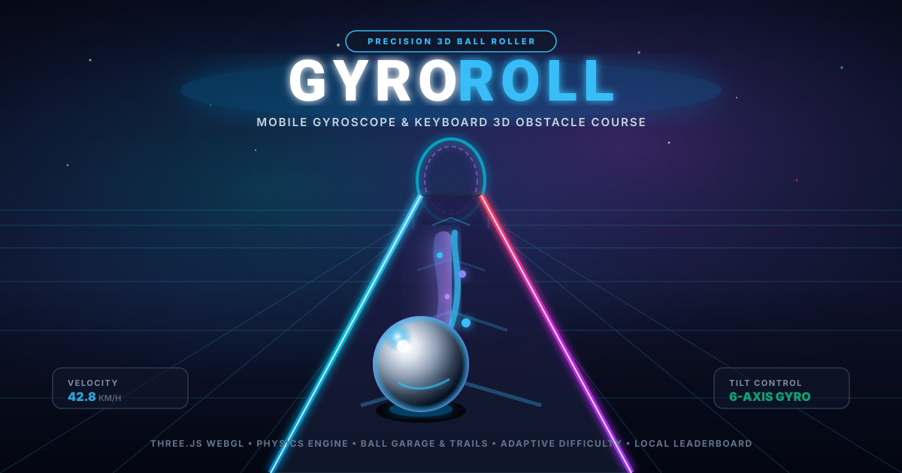

<div align="center">



# GYRO ROLL — 3D Physics Obstacle Course

[](https://vitejs.dev/)
[](https://react.dev/)
[](https://threejs.org/)
[](https://www.typescriptlang.org/)
[](https://tailwindcss.com/)
[](./LICENSE)

**A high-precision 3D rolling obstacle course game designed for mobile phone gyroscope steering and desktop keyboard controls.**

[Play Now](#quick-start) • [Controls](#controls) • [Physics Engine](#physics--continuous-collision) • [Tracks](#tracks--hazards) • [Garage Customization](#ball-garage--custom-trails) • [Tech Stack](#tech-stack)

</div>

---

## 🎮 Overview

**GYRO ROLL** challenges players to navigate a physical rolling sphere down elevated futuristic courses suspended above cybernetic landscapes. Inspired by the progression and razor-sharp precision of *Trials* and classic marble roller games, GYRO ROLL utilizes a true **third-person forward-facing chase camera** positioned behind and slightly above the ball, framing upcoming track hazards, chicanes, and jumps for maximum anticipation.

### Key Highlights
- 📱 **Native Gyroscope Steering**: Tilt your mobile phone left or right to steer with real-time responsive 6-axis device orientation.
- ⚡ **Continuous Collision Detection (CCD)**: Robust anti-tunneling physics prevents the ball from clipping or rolling through track floors and guardrails.
- 🎯 **Balanced, Deliberate Speed**: Tuned forward cruise velocity (~40 km/h) and controllable steering give players the reaction time needed to master tight balance bridges and moving obstacles.
- 🎨 **Ball Garage & Live Trail Editor**: 6 distinct sphere materials and 8 procedural particle trails with interactive slider customization (trail length, particle density, color palette, and glow intensity).
- 🏆 **Top 10 Local Leaderboards**: Persistent fastest-run tracking with split timing against Gold pace at every checkpoint.
- 🧠 **Adaptive Difficulty System**: Subtle, intelligent track modifications (forgiving guardrails or tighter hazard gaps) based on player performance.
- 🌦️ **Dynamic Weather Systems**: Lightweight, low-overhead weather particles (falling snow, neon rain streaks, drifting embers) tailored to each track environment.
- 📳 **Haptic Feedback**: Short vibration pulses when colliding with obstacles or completing stages on supported mobile devices.

---

## 🕹️ Controls

GYRO ROLL automatically detects your input device and calibrates accordingly:

| Input Method | Steer Left / Right | Accelerate / Push | Brake / Reverse | Respawn Checkpoint |
| :--- | :--- | :--- | :--- | :--- |
| **Mobile Gyroscope** | Tilt Phone Left / Right | Auto-cruise / Screen Touch | Touch Brake button | Tap Reset button |
| **Keyboard (WASD)** | <kbd>A</kbd> / <kbd>D</kbd> | <kbd>W</kbd> | <kbd>S</kbd> or <kbd>Space</kbd> | <kbd>R</kbd> |
| **Keyboard (Arrows)** | <kbd>←</kbd> / <kbd>→</kbd> | <kbd>↑</kbd> | <kbd>↓</kbd> | <kbd>R</kbd> |
| **Gamepad / Controller** | Left Stick (X-axis) | Right Trigger / Button A | Left Trigger / Button B | Button Y / Select |

> **Mobile Tip**: On iOS and modern Android browsers, tap **"Enable Gyro Tilt"** on the title screen to grant device motion sensor permissions.

---

## ⚡ Physics & Continuous Collision

The physics engine is custom-built in TypeScript (`src/game/physics.ts`) to deliver responsive rolling mechanics without heavy third-party physics overhead:

1. **Anti-Tunneling & Surface Clamping**:
   - Multi-segment evaluation with wide penetration safety tolerances (up to 3.0 units) ensures the ball never clips through track joints or downslopes during high downward velocity.
   - Dual-pass resolution: Pre-step support detection and post-integration continuous surface snapping.
2. **True Physical Rolling**:
   - Angular velocity is strictly coupled to surface speed ($\omega_x = -v_z / R$, $\omega_z = v_x / R$) for realistic rotational inertia.
3. **Guardrail Encasement**:
   - Segments with `hasRails: true` clamp lateral coordinates inside barrier bounds and reflect velocity using restitution bounce factors.
4. **Surface Interactions**:
   - **Tarmac / Normal**: Standard high-grip rolling friction ($0.985$).
   - **Neon Ice**: Low-traction drifting friction ($0.998$) requiring counter-steering.
   - **Boost Strips**: Instant forward propulsion leaps.
   - **Bouncy Launchers**: Vertical spring trajectories over gaps and obstacles.

---

## 🏁 Tracks & Hazards

### 1. Aero Highlands (Beginner)
- **Vibe**: Sunny mountain ridge with gentle chicanes, balance bridges, and beginner boost jumps.
- **Weather**: Light falling snow particles.
- **Target Times**: Gold: `26.0s` | Silver: `38.0s` | Bronze: `55.0s`

### 2. Neon Citadel (Intermediate)
- **Vibe**: Cyberpunk highway with alternating ice sections, oscillating platform bridges, and twin pendulum hammers.
- **Weather**: Cyber neon rain streaks.
- **Target Times**: Gold: `38.0s` | Silver: `52.0s` | Bronze: `75.0s`

### 3. Quantum Gauntlet (Expert)
- **Vibe**: Hardcore aerial speedway featuring razor-thin balance beams (1.8m width), rolling boulders, slalom gates, and supersonic jump gaps.
- **Weather**: Molten orange embers.
- **Target Times**: Gold: `48.0s` | Silver: `66.0s` | Bronze: `95.0s`

---

## 🚗 Ball Garage & Custom Trails

The Garage allows instant customization and real-time 3D inspection:

- **Skins**:
  - `Chrome Mirror` — High-specularity metallic silver.
  - `Cyber Neon` — Emissive cyan grid sphere.
  - `Magma Core` — Glowing volcanic crust texture.
  - `Quantum Hologram` — Iridescent refractive Fresnel shell.
  - `Carbon Fiber` — Matte woven composite weave.
  - `Gold Elite` — Lustrous 24K polished gold.

- **Animated Trails**:
  - `Classic Energy`, `Neon Ribbon`, `Plasma Flow`, `Digital Matrix`, `Electric Sparks`, `Cosmic Nebula`, `Fireball`, `Sonic Wave`.
- **Live Tuning**:
  - Adjust **Trail Length** ($0.5\times$ to $2.5\times$)
  - Adjust **Particle Density** ($0.5\times$ to $2.0\times$)
  - Customize **Color Palette** (Cyan, Purple, Emerald, Gold, Rose)
  - Control **Glow / Bloom Intensity**

---

## 🛠️ Tech Stack

- **Core**: [React 19](https://react.dev/), [TypeScript 5.x](https://www.typescriptlang.org/), [Vite 6](https://vitejs.dev/)
- **3D Graphics**: [Three.js r174](https://threejs.org/) (Custom WebGL shaders, PMREM environment lighting, procedural textures)
- **Styling**: [Tailwind CSS v4](https://tailwindcss.com/)
- **Icons**: [Lucide React](https://lucide.dev/)
- **Audio**: Web Audio API procedural synthesizers (low rumble, checkpoint chimes, impact tones)
- **Storage**: Browser `localStorage` for progress, unlocked skins, best times, and adaptive difficulty history

---

## 🚀 Quick Start

### Prerequisites
- [Node.js](https://nodejs.org/) (version 18 or higher recommended)
- `npm` or `bun`

### Installation

```bash
# 1. Clone the repository
git clone https://github.com/your-username/gyro-roll.git
cd gyro-roll

# 2. Install dependencies
npm install

# 3. Start local development server
npm run dev
```

Open your browser at `http://localhost:3000` to play.

### Running Unit Tests

The test suite validates physics sub-stepping, rail collisions, anti-penetration clamping, adaptive difficulty curves, and cosmetic save state:

```bash
npm test
# Or using tsx directly:
npx tsx --test src/game/*.test.ts
```

### Production Build

```bash
npm run build
```

The optimized static assets will be generated in `/dist`.

---

## 📄 Robots & Crawlers

Search crawler instructions are configured in `/public/robots.txt`:
```txt
User-agent: *
Allow: /
Disallow: /api/
Disallow: /node_modules/
```

---

## 📜 License

This project is open-source and available under the [MIT License](./LICENSE).
